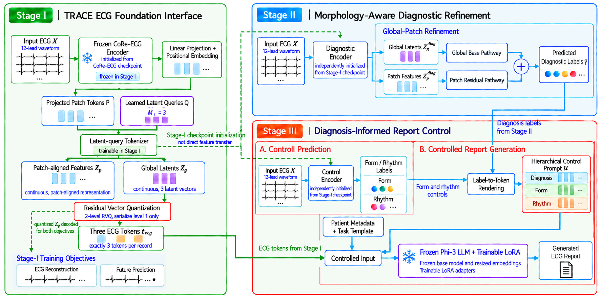

# TRACE

<p align="center">
  
</p>

TRACE is an ECG foundation-interface framework for diagnosis refinement and diagnosis-informed report control. The repository contains the core training, evaluation, and inference scripts for PTB-XL, CPSC2018, and Ningbo.

## Installation

Create the Python environment following `env/README.md`. The tested setup uses Python 3.10, PyTorch 2.5.1, CUDA 11.8, and the Hugging Face/PEFT training stack.

```bash
conda create -n trace python=3.10 -y
conda activate trace
python -m pip install --upgrade pip
```

Then install the dependencies listed in `env/README.md`.

## Data and Checkpoints

Public ECG waveform files are not redistributed. Prepare the datasets from their original providers and place metadata or preprocessed arrays under `data/`, or pass explicit paths to the scripts.

This release does not redistribute trained dataset-specific weights. Only the shared CoRe-ECG mimic pretrained encoder initialization is kept:

```text
ckpt/
  pretrained_weight/CoRe-ECG_mimic_encoder.pth
  ptbxl/       # empty output skeleton; generated by PTB-XL training
  cpsc2018/    # empty output skeleton; generated by CPSC2018 training
  ningbo/      # empty output skeleton; generated by Ningbo training
```

Run the training commands below to regenerate ECG tokenizers, diagnosis checkpoints, report-control heads, LoRA adapters, and merged report models.

For report training, TRACE uses Phi-3-mini-4k-instruct by default. To use a local offline copy, set:

```bash
export TRACE_BASE_LM_PATH=path/to/Phi-3-mini-4k-instruct
```

## Usage

The commands below are plain foreground commands. Set `CUDA_VISIBLE_DEVICES` yourself when selecting GPUs.

### PTB-XL

Prepare:

- `data/ptbxl_database.csv`
- `data/scp_statements.csv`
- `data/records2250.npy` for diagnosis/tokenizer training
- `data/full_data.npy` for report-control/report training

Train the ECG tokenizer:

```bash
python train_tokenizer_ptbxl.py
```

Train the report-control head:

```bash
python report_control_train_ptbxl.py \
  --metadata-csv data/ptbxl_database.csv \
  --scp-statements-csv data/scp_statements.csv \
  --signals-npy data/full_data.npy
```

Train the diagnosis refinement checkpoint:

```bash
python train_diagnosis_ckpt.py \
  --dataset ptbxl \
  --metadata-csv data/ptbxl_database.csv \
  --scp-statements-csv data/scp_statements.csv \
  --signals-npy data/records2250.npy
```

Evaluate diagnosis:

```bash
python eval_diagnosis_ptbxl.py \
  --eval-only \
  --downstream-checkpoint ckpt/ptbxl/downstream_refined/best.pt \
  --metadata-csv data/ptbxl_database.csv \
  --scp-statements-csv data/scp_statements.csv \
  --signals-npy data/records2250.npy
```

Train the report language branch:

```bash
python train_report_ptbxl.py
```

Generate PTB-XL reports:

```bash
python infer_report_ptbxl.py \
  --split test \
  --output_prefix data/generated_ptbxl_st2
```

Evaluate PTB-XL report-generation metrics:

```bash
python eval_ptb_report_generation_metrics.py \
  --input-json data/generated_ptbxl_st2_reports.json \
  --output-json data/generated_ptbxl_st2_nlg_metrics.json \
  --bertscore
```

### CPSC2018

Prepare:

- `data/TRAIN_reference_cpsc2018.csv`
- `data/VAL_reference_cpsc2018.csv`
- `data/TEST_reference_cpsc2018.csv`
- `data/records2250_cpsc2018_train.npy`
- `data/records2250_cpsc2018_val.npy`
- `data/records2250_cpsc2018_test.npy`

Train the ECG tokenizer:

```bash
python train_tokenizer_cpsc2018.py
```

Train the report-control head:

```bash
python report_control_train_cpsc2018.py \
  --train-reference-csv data/TRAIN_reference_cpsc2018.csv \
  --valid-reference-csv data/VAL_reference_cpsc2018.csv \
  --test-reference-csv data/TEST_reference_cpsc2018.csv \
  --train-signals-npy data/records2250_cpsc2018_train.npy \
  --valid-signals-npy data/records2250_cpsc2018_val.npy \
  --test-signals-npy data/records2250_cpsc2018_test.npy
```

Train the diagnosis refinement checkpoint:

```bash
python train_diagnosis_ckpt.py \
  --dataset cpsc2018 \
  --train-reference-csv data/TRAIN_reference_cpsc2018.csv \
  --valid-reference-csv data/VAL_reference_cpsc2018.csv \
  --test-reference-csv data/TEST_reference_cpsc2018.csv \
  --train-signals-npy data/records2250_cpsc2018_train.npy \
  --valid-signals-npy data/records2250_cpsc2018_val.npy \
  --test-signals-npy data/records2250_cpsc2018_test.npy
```

Evaluate diagnosis:

```bash
python eval_diagnosis_cpsc2018.py \
  --eval-only \
  --downstream-checkpoint ckpt/cpsc2018/downstream_refined/best.pt \
  --train-signals-npy data/records2250_cpsc2018_train.npy \
  --valid-signals-npy data/records2250_cpsc2018_val.npy \
  --test-signals-npy data/records2250_cpsc2018_test.npy
```

Train the report language branch:

```bash
python train_report_cpsc2018.py
```

Run structured report/control inference:

```bash
python infer_report_cpsc2018.py
```

### Ningbo

Prepare a Ningbo root directory with split index files and ECG arrays:

```text
data/ningbo/
  train_index.csv
  val_index.csv
  test_index.csv
  data/
```

Train the ECG tokenizer:

```bash
python train_tokenizer_ningbo.py \
  --ningbo-root data/ningbo
```

Train the report-control head:

```bash
python report_control_train_Ningbo.py \
  --ningbo-root data/ningbo \
  --label-names-json data/ningbo_label_names_25.json
```

Train the diagnosis refinement checkpoint:

```bash
python train_diagnosis_ckpt_ningbo.py \
  --ningbo-root data/ningbo \
  --label-names-json data/ningbo_label_names_25.json
```

Evaluate diagnosis:

```bash
python eval_diagnosis_ningbo.py \
  --ningbo-root data/ningbo \
  --label-names-json data/ningbo_label_names_25.json \
  --eval-only \
  --downstream-checkpoint ckpt/ningbo/downstream_refined/best.pt
```

Train the report language branch:

```bash
python train_report_ningbo.py
```

Run structured report/control inference:

```bash
python infer_report_ningbo.py \
  --ningbo_root data/ningbo \
  --label_names_json data/ningbo_label_names_25.json \
  --split test \
  --output_prefix data/generated_Ningbo_st2
```

## Notes

- PTB-XL supports narrative report-generation evaluation with BLEU, METEOR, ROUGE-L, BERTScore, and CIDEr-D.
- CPSC2018 and Ningbo do not provide the same public paired narrative report targets, so their report scripts are used for structured control/report consistency rather than PTB-XL-style narrative report benchmarking.
- See `data/README.md` for the files retained in this repository and the public data files that must be downloaded separately.
